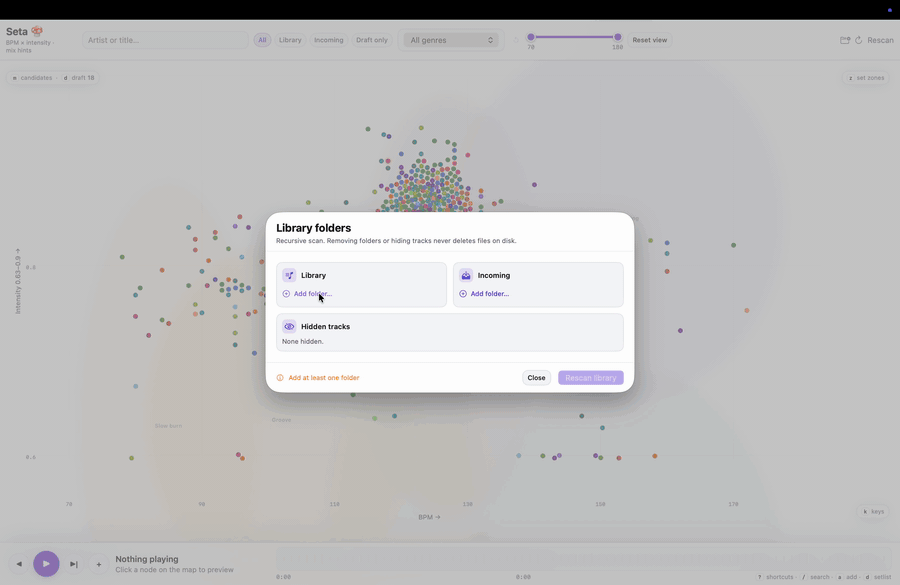
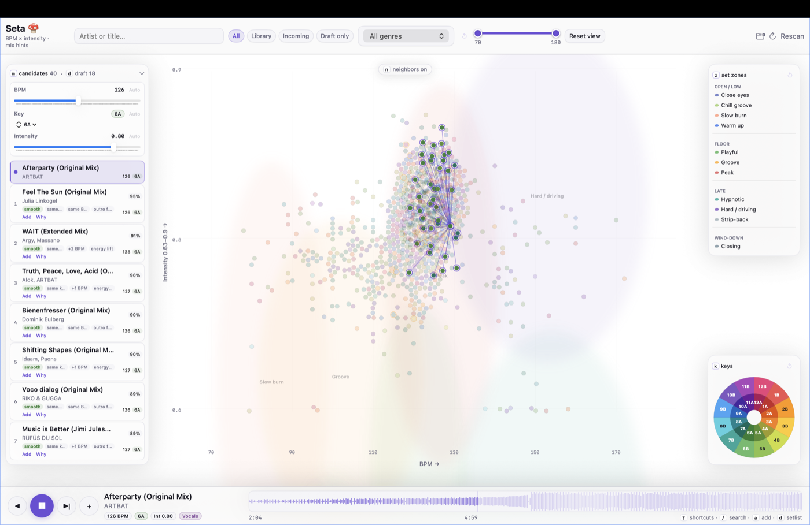

# SetaMac 🍄

**Draft a DJ set from a map of your own library.** A local-first macOS app: every track sits on a BPM × intensity map, you pick a seed track, and SetaMac shows what mixes well next and why. When the journey feels right, export it to Rekordbox.

[](https://github.com/manupastorr/seta-mac/actions/workflows/ci.yml)


[](LICENSE)

**[Download the latest release](https://github.com/manupastorr/seta-mac/releases/latest)** · [Install guide](docs/DOWNLOAD.md) · [Changelog](CHANGELOG.md)



## Why

The hard part of a set is not finding tracks, it is the story between them. Playlists force an order too early. SetaMac keeps the first, creative phase on a map: you see your whole library by tempo and energy, follow smooth mixes from one track to the next, and only fix the order when the journey makes sense.

## What it does

| | |
|---|---|
| **Library map** | Every track on a BPM × intensity map, colored by Camelot key, with set zones (warm up, groove, peak, closing) in the background. |
| **Mix candidates** | Pick a track and see ranked next tracks: same or compatible key, small BPM steps, energy lift, intro/outro fit. Each candidate says *why*. |
| **Set draft** | Add tracks, repair weak links, shape the energy ramp. |
| **Rekordbox in and out** | Import playlists from Rekordbox, export the draft back as a playlist. |
| **Local analysis** | A bundled Python scanner reads BPM, key, intensity, vocals and waveforms from the folders you choose. Your files never move and never leave your Mac. |
| **No Terminal** | First launch runs a one-click setup. Tracks appear on the map in batches while the scan continues. |



## Install

1. Download the latest `SetaMac-*.zip` from [Releases](https://github.com/manupastorr/seta-mac/releases/latest).
2. Unzip it and move **SetaMac.app** to Applications.
3. Right-click **SetaMac.app** → **Open** → **Open**. If macOS says the app is "damaged", follow [these steps](docs/DOWNLOAD.md#if-macos-blocks-the-app).
4. In the app, click **Start setup** and wait (needs internet once).
5. Add your music folders in **Library → Library Folders…**, then **Rescan library**.

## How it is built

```
Sources/SetaMacApp    SwiftUI macOS app: map, mix dock, player, sheets
Sources/SetaMacCore   Domain logic: library model, Camelot, scoring, drafts, Rekordbox import/export
Sources/SetaMacChecks Smoke and validation checks for the core
Scanner/              Python audio scanner bundled into every release (58 unit tests)
scripts/              Build, sign, notarize, package and release
```

- **Scoring** combines key compatibility (Camelot), BPM distance, intensity change and intro/outro fit into one mix score with a readable reason.
- **The scanner** analyzes audio with librosa and writes a `library.json` the app reads. A per-file cache makes rescans fast.
- **Releases** are built, packaged and checked by `scripts/verify-all.sh`; CI builds the Swift targets and runs the scanner tests on every push.

## Development

```bash
swift build
swift run SetaMacChecks
./scripts/verify-all.sh
```

Release convention: bump `VERSION`, add a matching `CHANGELOG.md` section, commit, then run `./scripts/release-github.sh`.

## Related

[seta-web](https://github.com/manupastorr/seta-web) is the browser version I use for arranging a full set: mix curves over waveforms, transition checks, and export with cue points to Rekordbox.

## License

MIT. Made by [Manu Pastor](https://manupastor.de/dj/), a DJ who builds his own tools.
